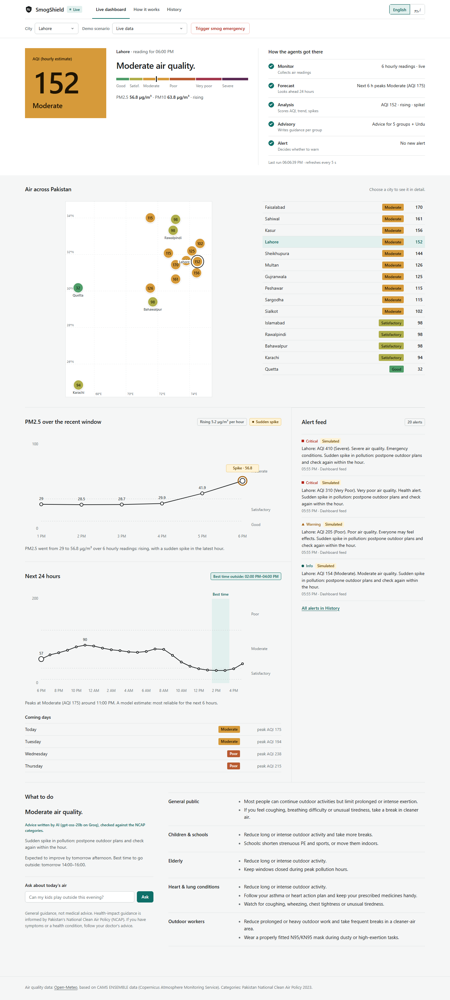
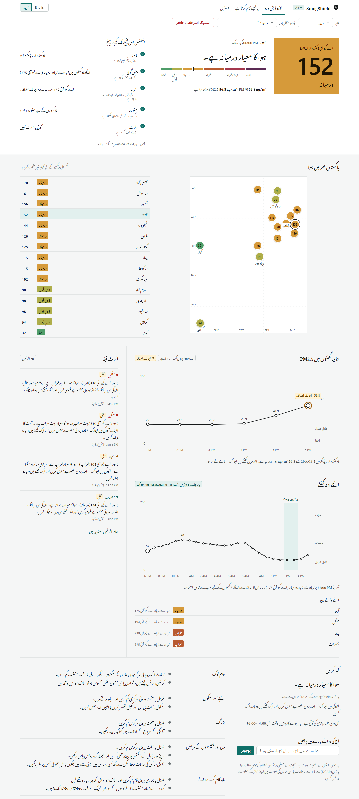
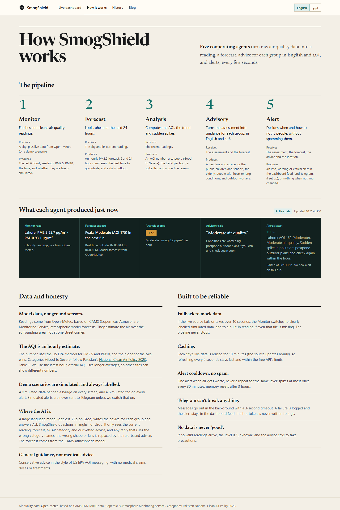

# SmogShield

A modular multi-agent system that monitors air quality and coordinates smog response in real time.

```
monitor ──► forecast ──► analysis ──► advisory ──► alert ──► dashboard
(Open-Meteo (next 24 h,  (AQI, level,  (public      (feed /
 mock data)  best time,   trend,       guidance,    Telegram,
             outlook)     spike)       Urdu)        [FORECAST])
```

Agents are plain Python functions wired together with [LangGraph](https://github.com/langchain-ai/langgraph).
They share one state object defined in [`schemas.py`](schemas.py). Each agent writes only its own key.

## Problem

Every winter, smog in Punjab pushes the air into the worst categories for days at a time. Schools close, hospitals fill with breathing problems, and outdoor workers keep working in it. Readings exist, but a number like "AQI 310" doesn't tell a parent, a teacher or a labourer what to do. Most of the advice that does exist is in English and uses US categories, not Pakistan's own scale.

## Solution

SmogShield turns hourly air-quality data into clear, timely advice for the people most at risk, in English and Urdu:

- It reads PM2.5 and PM10 for 15 Pakistani cities and scores them on Pakistan's NCAP 2023 categories (Good to Severe).
- It looks 24 hours ahead to warn before the air gets worse and to find the best time to go outside.
- It writes advice for five groups: the public, children and schools, the elderly, people with heart or lung conditions, and outdoor workers.
- It sends alerts that escalate with the air (info → warning → critical) without spamming, including predictive `[FORECAST]` alerts.
- People can ask questions in plain English or Urdu ("Can my kids play outside this evening?") and get an answer grounded in the current reading.

## Features

- **Live dashboard:** AQI, NCAP category, trend and spike detection, and a ledger showing what each agent did.
- **City map:** all 15 cities at a glance, worst air first. Click one to switch.
- **24-hour forecast chart:** the peak, the best time to go out, and a daily outlook.
- **Next school day:** the worst forecast air from 7 AM to 2 PM tomorrow (Monday when tomorrow is Sunday), and what schools should do, from "a normal day" to "move PE and assembly indoors" to "consider closing". Built for Lahore's winter smog season, when Punjab has closed schools for days at a time. It's a suggestion, not an official notice.
- **Advice for 5 groups**, written by AI when it's switched on and always checked against the rules.
- **Ask SmogShield:** questions in English or Urdu, answered from the live data.
- **Share on WhatsApp:** one tap sends today's advice (headline, the general public, children and schools) to a family or school group, in the site's language. Simulated data is marked in the message.
- **Read aloud:** the browser's built-in speech reads the advice, for people who find reading hard. It uses an Urdu voice when the device has one, and otherwise reads the English advice and says so.
- **Last 7 days for every city:** seven small squares beside each city, coloured by each day's 24-hour average PM2.5 (the basis NCAP categories are defined on). Always real data, even during a demo scenario.
- **Alert feed and history**, with optional Telegram delivery.
- **The whole site in English or اردو:** right-to-left layout and the Nastaliq font.
- **Demo scenarios** (always labelled SIMULATED) to show a smog emergency on stage.

## Screenshots

| Dashboard | اردو |
|---|---|
|  |  |



## Tech stack

- **Backend:** Python 3.11+, [LangGraph](https://github.com/langchain-ai/langgraph) (agent orchestration), FastAPI + uvicorn, requests.
- **Frontend:** plain HTML, CSS and JavaScript (no framework, no build step, no CDNs), with the Noto Nastaliq Urdu font.
- **Data:** [Open-Meteo](https://open-meteo.com) air-quality API (CAMS model data, no key needed).
- **AI:** [Groq](https://groq.com) API running `openai/gpt-oss-20b` (configurable).
- **Alerts:** dashboard feed, plus Telegram Bot API (optional).
- **Tests:** Python `unittest` (235 tests, no network needed).

## AI methodology

SmogShield is a **multi-agent system**: five agents, orchestrated by LangGraph, share one state object.

```
monitor → forecast → analysis → advisory → alert
```

Where each kind of intelligence is used:

| Part | Method | Why |
|---|---|---|
| **Forecast** | Hourly PM2.5/PM10 forecasts from the CAMS atmospheric model (via Open-Meteo), turned into peaks, trend, confidence (high 0–6 h, medium 6–24 h, low after) and the best ~2-hour window | A physics-based model is far more reliable than anything we could train in 3 days |
| **Analysis** | US EPA AQI formula for PM2.5 and PM10, NCAP 2023 categories, trend by least squares, spike detection against the recent window | Health categories must be exact and explainable, so this is deterministic |
| **Advisory** | **LLM** (`gpt-oss-20b` on Groq) writes advice for the 5 groups from the NCAP category, its NCAP health-impact text and our vetted rule-based advice | Advice that reads naturally and fits the situation, without inventing medical claims |
| **Ask SmogShield** | **LLM** answers free-text questions in English or Urdu, given only the current reading, forecast, NCAP category and vetted advice | People ask in their own words; the answer stays tied to real data |
| **Alert** | Rules: severity from the level, escalation, cooldown, forecast warnings | Alerts must be predictable and never spam |

**Guardrails on the LLM (so judges and users can trust it):**

- **The model never decides the air category.** The NCAP headline and category always come from the analysis agent.
- **Replies are rejected** when they are invalid JSON, have the wrong shape, are missing a group, or use another scale's words ("unhealthy", "hazardous"). The rule-based advice is used instead.
- **The code picks the reply language** (Urdu script in, Urdu out). Simulated data is labelled by code, not by the model.
- **Usage is efficient:** advice is cached for 10 minutes per level, a failure isn't retried for 1 minute, and requests use low reasoning effort. Rate limits show a calm "busy" message.
- **The dashboard says who wrote the advice**, either "Advice written by AI (gpt-oss-20b on Groq)" or "Advice from SmogShield's NCAP rules". Every Ask answer shows "Answered by AI" and the data it was based on.
- **The AI is opt-in.** It needs `LLM_ADVISORY_ENABLED=true` and `GROQ_API_KEY` in `.env` (see [Advisory](#advisory)). Without them, everything still works on the rules.

**Third-party AI APIs:** Groq (`openai/gpt-oss-20b`). **Data APIs:** Open-Meteo (CAMS, Copernicus Atmosphere Monitoring Service).

## Known limitations

- **Model data, not ground sensors.** CAMS covers cells about 40 km wide, so nearby cities (Islamabad and Rawalpindi) can show the same values.
- **The AQI is an hourly estimate.** Official AQI uses 24-hour averages, so other sites can show different numbers.
- **The forecast is CAMS's.** We haven't trained our own model yet.
- **AI advice is English only.** The Urdu advice is rule-based and machine-drafted, and still needs review by a native speaker.
- **The Groq free tier has rate limits.** When they are hit, the app falls back to the rules.
- **It's a single demo server with no login.** It runs on 127.0.0.1 only, and the city and scenario are shared by everyone using it.
- **Not medical advice.** It is general guidance only.

## Future work

- **Ground sensors:** blend in PEPA and community sensors (such as PurpleAir).
- **Our own forecast model:** a trained correction on top of CAMS for each city.
- **Reach people off the web:** SMS and WhatsApp alerts.
- **Schools:** a mode for deciding about closures and PE.
- **More languages:** Punjabi and Sindhi, and AI-written Urdu advice once it has been reviewed.

## AI tools used in development

The team used AI coding assistants (Claude Code and GitHub Copilot) to help write and review code. We read, tested (235 automated tests plus manual tests in both languages, at desktop and phone widths) and understand everything we submit. The AI *inside* the product is the Groq LLM described above.

## Quick start

Requires Python 3.11+.

```bash
python -m venv .venv
# Windows: .venv\Scripts\activate    macOS/Linux: source .venv/bin/activate
pip install -r requirements.txt
cp .env.example .env                  # optional, see Configuration (Windows: copy .env.example .env)
python -m unittest discover tests -v  # all tests, no network needed
python graph.py                       # self-check, should print OK
uvicorn app:app --reload              # open http://localhost:8000
```

By default the app uses live data for Lahore. If the network is down, it falls back to `data/mock_readings.json` and the dashboard says so with a **SIMULATED DATA** banner.

## Running the server safely

- **Run uvicorn on 127.0.0.1 only** (its default, as in the command above). **Never use `--host 0.0.0.0`**: the API has no login, so anyone on the same Wi-Fi could switch the demo scenario or trigger the pipeline.
- **Use a single worker** (the default; never pass `--workers`). Alert memory and the feed live in one file, `var/alerts.json`, guarded by an in-process lock, and the demo scenario control changes the running process. Several workers would each keep their own state and could send duplicate alerts.
- Restart the server after editing `.env`; it is only read at startup.

## Tests

```bash
python -m unittest discover tests -v
```

The tests need no network and never send real messages: they clear `TELEGRAM_*` and fake every HTTP call. `python graph.py` is a self-check that runs the whole pipeline once; it also never sends to Telegram and never writes the real alert feed. Run both before every PR.

## Project layout

| Path | What it is |
|------|-----------|
| `schemas.py` | Contracts between agents. Change these as a team. |
| `agents/monitor.py` | Fetches the last 6 hours from Open-Meteo, falls back to mock data |
| `agents/forecast.py` | Hourly PM2.5 forecast from Open-Meteo: next 24 h (AQI, level, confidence), 6 h and 24 h summaries, best ~2-hour window to go outside, multi-day outlook; falls back to a scripted mock forecast |
| `agents/analysis.py` | PM2.5 and PM10 → AQI estimate, NCAP category, trend, spike flag (see [How the AQI is calculated](#how-the-aqi-is-calculated)) |
| `agents/advisory.py` | Level and forecast → guidance per audience, including outdoor workers, plus a forecast note (+ Urdu); optional Groq enhancement with rule-based fallback |
| `agents/alert.py` | Decides whether to alert, how loudly, and delivers it, including predictive `[FORECAST]` alerts |
| `graph.py` | LangGraph orchestrator + self-check |
| `app.py` | FastAPI server: dashboard and API (below) |
| `web/` | Dashboard: `index.html`, `styles.css`, `app.js` (plain HTML/CSS/JS, no build step, no CDNs) and `fonts/` (Noto Nastaliq Urdu, SIL Open Font License) |
| `data/mock_readings.json` | Demo scenarios |
| `data/mock_forecasts.json` | Scripted forecast curve per demo scenario (multipliers of the current PM2.5 by hours ahead) |
| `tests/` | Unit and end-to-end tests |
| `var/` | Runtime data, created on first alert, gitignored: `var/alerts.json` holds the alert feed and alert memory. Delete it to start with an empty feed. |

## How the AQI is calculated

- **Readings:** hourly PM2.5 and PM10 from [Open-Meteo](https://open-meteo.com). These are CAMS model estimates, not ground sensors.
- **AQI number:** US EPA method with the 2024 breakpoints. PM2.5 and PM10 each get a sub-index, and the AQI is the higher of the two. The dashboard says "AQI driven by PM10" when PM10 is the higher one.
- **Category:** Pakistan's [National Clean Air Policy (NCAP) 2023](https://mocc.gov.pk/SiteImage/Misc/files/NCAP%20(28-02-2023)%20v1.pdf), Table 1:

  | AQI | Category |
  |-----|----------|
  | 0–50 | Good |
  | 51–100 | Satisfactory |
  | 101–200 | Moderate |
  | 201–300 | Poor |
  | 301–400 | Very Poor |
  | 401–500 | Severe |

- **Why the US EPA method:** NCAP defines the categories but does not publish concentration breakpoints, and its references cite US EPA "AQI Basics". So the number follows US EPA and the category follows NCAP.
- **National targets:** the dashboard also compares the readings with NCAP Table 2's 24-hour targets (PM2.5 75 µg/m³, PM10 150 µg/m³), for example "PM2.5 is 2.4× the national 24-hour target".
- **Honesty note:** official AQI uses 24-hour averages. Ours is an estimate from the latest hourly reading, so it reacts faster and other sites may show different numbers.

The code is in [`agents/analysis.py`](agents/analysis.py).

## API

| Method and path | What it does |
|-----------------|--------------|
| `GET /` | The live dashboard (Screen 1) |
| `GET /how` | How it works (Screen 2): the agent pipeline, a live example, data honesty and safeguards |
| `GET /api/status` | Runs the whole pipeline once and returns `readings`, `forecast`, `analysis`, `advisory`, `alerts` (new alerts from this run). The dashboard polls it every 5 s. |
| `POST /api/ask` | "Ask SmogShield": body `{"question": "..."}` (1–300 characters, English or Urdu). Runs the pipeline once and asks Groq to answer only from the current reading, forecast, NCAP category and vetted advice. Returns `{"answer", "source"}`; `source` is `ai`, or `off` / `busy` / `down` / `fallback` with a calm message. Needs `LLM_ADVISORY_ENABLED=true` and a Groq key. |
| `GET /api/alerts?limit=20` | The alert feed, newest first |
| `GET /api/scenario` | The forced mock scenario (`live` = none) and the list of options |
| `POST /api/scenario/{name}` | Demo control: force a scenario, or `live` to go back. Also clears the alert memory so the new scenario alerts right away. Lasts until the server restarts. |
| `GET /api/city` | The monitored city and the list of known cities |
| `POST /api/city/{name}` | Switch the monitored city (any case; unknown names give 404). Lasts until the server restarts. |
| `GET /static/...` | Dashboard files from `web/` |

Open the dashboard in Urdu with `http://localhost:8000/?lang=ur` (the language toggle is remembered per browser).

## Configuration

Settings live in `.env`, which `app.py` and `graph.py` load at startup. Copy `.env.example` to `.env` and edit it. **Never commit `.env`**; it is gitignored. Every setting is optional, and no API keys are needed for live data.

### Data (monitor)

| Variable | Default | What it does |
|----------|---------|--------------|
| `USE_MOCK` | `false` | `true` skips the network and always uses `data/mock_readings.json`. |
| `MOCK_SCENARIO` | unset | Forces mock data for one scenario: `good`, `satisfactory`, `moderate`, `poor`, `very_poor`, `severe`, `spike`. |
| `MONITOR_CITY` | `Lahore` | City to watch: Lahore, Karachi, Islamabad, Rawalpindi, Faisalabad, Multan, Peshawar, Quetta, Gujranwala, Sialkot, Sheikhupura, Kasur, Sahiwal, Sargodha, Bahawalpur (any case). |
| `LIVE_CACHE_MINUTES` | `10` | Reuse a city's live data this long before asking Open-Meteo again (it updates hourly). `0` = no cache. |
| `FORECAST_CACHE_MINUTES` | `30` | Reuse a city's live forecast this long before asking Open-Meteo again. `0` = no cache. The forecast follows the same `USE_MOCK`, `MOCK_SCENARIO` and dashboard scenario switch as the monitor. |

### Advisory

| Variable | Default | What it does |
|----------|---------|--------------|
| `LLM_ADVISORY_ENABLED` | `false` | Opt in to Groq-generated English advice. The validated rule-based advice remains the fallback. |
| `GROQ_API_KEY` | placeholder | Groq API key. Keep the real key in local `.env` only; never commit or share it publicly. |
| `GROQ_MODEL` | `openai/gpt-oss-20b` | Groq model used for optional advisory generation. Fast and light on tokens; each Groq model has its own daily token quota (free tier: 200k/day for gpt-oss-120b). |

When enabled, Groq receives the NCAP category name, its NCAP health impact and the rule-based advice to build on. It returns JSON with general actions and advice for all five audiences; the headline and the trend/forecast notes always stay rule-based. Answers are cached per level for 10 minutes (at most 6 calls per 10 minutes, so the free tier's 8,000 tokens/minute stays free for Ask SmogShield). Missing configuration, API failures, timeouts, invalid JSON, an invalid response shape, or a reply using another scale's category names (such as "unhealthy" or "hazardous") use the deterministic rule-based advice instead.

The rule-based health guidance is informed by Pakistan's [National Clean Air Policy (NCAP)](http://faolex.fao.org/docs/pdf/pak233407.pdf), especially its discussion of PM2.5-related respiratory and cardiovascular impacts and vulnerable groups. It is general information, not medical advice.

### Alerts

| Variable | Default | What it does |
|----------|---------|--------------|
| `ALERT_COOLDOWN_MINUTES` | `30` | After an alert, how long before the same place can alert again for a spike or after recovering. Getting worse always alerts immediately. |
| `ALERT_MEMORY_HOURS` | `3` | Alert memory older than this is forgotten, so a level that stays high alerts again. Memory is also cleared at startup whenever `USE_MOCK` or `MOCK_SCENARIO` forces mock data. |
| `TELEGRAM_BOT_TOKEN` | placeholder | Telegram bot token. A **secret**: put it in `.env` only. Leave the placeholder to use only the dashboard feed. |
| `TELEGRAM_CHAT_ID` | placeholder | The chat or group the bot posts to. |
| `ALERT_SIMULATIONS_TO_TELEGRAM` | `false` | Alerts from mock data are marked `[SIMULATION]` and stay in the dashboard feed. `true` also sends them to Telegram (e.g. to test the bot). |

**Predictive alerts:** when the air is better than Poor now but the forecast reaches Poor or worse within 6 hours, the alert agent sends a `warning` (never `critical`) starting with `[FORECAST]`, with kind `forecast`. It uses the same cooldown, memory expiry, `[SIMULATION]` and Telegram rules as other alerts, does not repeat for the same forecast peak, and stays quiet when a current-conditions alert already covers that level. Alerts stored before `kind` existed read as `current`.

**Telegram setup:** in Telegram, talk to @BotFather, send `/newbot`, and copy the token. Add the bot to your group and send a message there, then open `https://api.telegram.org/bot<token>/getUpdates` and copy `"chat":{"id": ...}`. Messages are sent in the background with a 3 s timeout; if one fails, the alert stays in the feed marked `failed: telegram: ...` and a warning is logged. The token is never written to logs.

## Demo tips

- **Switch scenarios from the dashboard's "Demo scenario" menu.** It takes effect on the next poll, clears the alert memory so the new scenario alerts at once, and "Live data" switches back. Nothing to restart.
- **Force a smog emergency:** pick `severe` (or set `MOCK_SCENARIO=severe` in `.env` and restart). Use `spike` to show air building from clean to severe and back, about one step every 5 seconds, with a "Sudden spike" badge and escalating alerts (info → warning → critical).
- **Mock data is always labelled:** the dashboard shows a SIMULATED DATA banner, and every alert from mock data starts with `[SIMULATION]` and is not sent to Telegram unless you allow it.
- **Rehearsals don't swallow the demo alert:** restarting with mock data forced, or switching scenario in the menu, clears the alert memory. To also start with an empty feed, stop the server and delete `var/alerts.json`.
- **Show a predictive alert:** pick `moderate`. Its scripted forecast climbs to Poor within a few hours, so a `[FORECAST]` warning arrives before conditions get there. `spike` and the high scenarios show forecasts that improve.
- **The forecast is a model estimate**, not a measurement: hourly CAMS model output from Open-Meteo, with confidence high for 0–6 h, medium for 6–24 h, low beyond. Mock forecasts are labelled as simulated.
- **The AQI is an estimate** from the latest hourly PM2.5 and PM10 (the dashboard says so). Official AQI uses 24-hour averages, so other sites may show different numbers. See [How the AQI is calculated](#how-the-aqi-is-calculated).

## Data attribution

Air quality data from [Open-Meteo](https://open-meteo.com) (free, no key, non-commercial use), based on CAMS ENSEMBLE data from the Copernicus Atmosphere Monitoring Service. If a live call fails or takes more than 10 s, the monitor falls back to mock data. The forecast uses the same API's hourly `pm2_5` and `pm10` forecast (`forecast_days=4`) and falls back to the scripted mock forecast the same way.

## Adding an agent

1. Create `agents/<name>.py` with `def run(state: SmogState) -> dict:` that returns only the keys it owns.
2. Add its output type and state key in `schemas.py`.
3. Add a node and edge in `graph.py`.

## Team

- **Rameen:** lead, orchestration, integration and reviews
- **Dania:** dashboard (3 screens), alert agent, forecast agent, Telegram, most of the pipeline
- **Fatima:** analysis agent, NCAP categories and PM10
- **Rida:** advisory agent and guidance
- **Halima:** monitor agent, cities, data documentation
